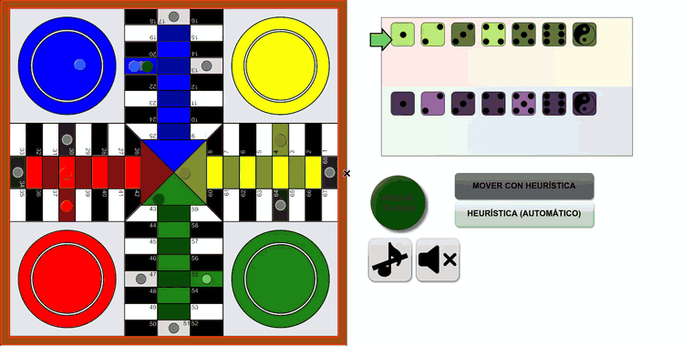
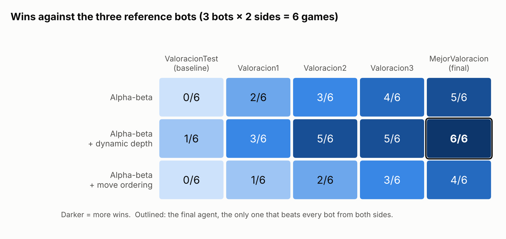

# Parchís AI: Minimax and alpha-beta pruning in C++

An AI player for a two-player version of Parchís (the Spanish cousin of Ludo), written in C++. It looks ahead several moves with Minimax and alpha-beta pruning, and it judges positions with a heuristic I designed and tuned step by step until it beat all three reference bots, playing from either side.

I built it for the Artificial Intelligence course of my Computer Engineering degree at the University of Granada (2024-25). The game engine was provided; the player in [`src/personal/`](src/personal) is my work.

<p align="center">
  
  <br><sub>My final agent (yellow and green) against the greedy player. Sped up, pauses removed.</sub>
</p>

## The game

Two players, each controlling two colours with two pieces per colour. Instead of rolling, each player chooses which die to use from their own set (1 to 6 plus a special one), so there is no chance involved: both players see everything and every move is a decision. This makes it a deterministic two-player game with perfect information, which is exactly the setting where Minimax applies.

The engine limits how much each player can think: every move has a budget of 3.5 million generated plus evaluated nodes. Any search has to respect it.

## What I implemented

**Search algorithms** ([`AIPlayer.cpp`](src/personal/AIPlayer.cpp)):

| Algorithm | Idea |
|---|---|
| Random / most advanced piece | Baselines with no lookahead |
| Greedy | Looks one move ahead: takes any move that captures, reaches the goal or wins |
| Minimax | Full game tree up to a fixed depth |
| Minimax with node limit | Same, but stops cleanly when the engine's node budget runs out |
| Alpha-beta | Minimax that skips branches which cannot change the decision (depth 6) |
| Alpha-beta + dynamic depth | When a position has fewer than 4 possible moves, it searches one level deeper there |
| Alpha-beta + move ordering | Evaluates and sorts the moves before expanding them, so the best ones are tried first |

**Heuristics**, each one built on the previous:

| Heuristic | What it adds |
|---|---|
| `ValoracionTest` | Baseline included with the engine: +1 per piece on a safe square, +5 per piece at the goal |
| `Valoracion1` | Progress of every piece towards the goal, a bonus for pieces at the goal and a penalty for pieces still at home |
| `Valoracion2` | Bonuses for pieces on safe squares and in the final corridor |
| `Valoracion3` | Events of the last move (capturing, reaching the goal, bouncing back from the goal), weighted differently if they happened on my turn or the opponent's |
| `MejorValoracion` | Penalties for walls blocking a piece's path; a wall built by my partner colour costs much less than an opponent's |

Every heuristic is symmetric: what counts for my pieces counts against me for the opponent's, with slightly different weights. For example, losing a piece costs 65 points while capturing one is worth 60, so the agent values keeping its pieces slightly more than taking the opponent's.

## Results

I tested every combination against the three reference bots (the "ninjas", levels 1 to 3), playing once as player 1 and once as player 2: six games per combination.

<p align="center">
  
</p>

- **The heuristic matters most.** With plain alpha-beta, the number of wins goes from 0/6 with the baseline heuristic to 5/6 with the final one, without changing the search at all.
- **Dynamic depth was the best improvement to the search.** Looking one move further in forced positions, where there are only a few options and a mistake is expensive, is what took the final heuristic from 5/6 to 6/6.
- **Move ordering did not make the agent stronger**, and now I understand why. At the same depth, alpha-beta returns the same value with or without ordering; ordering is only meant to make the search cheaper, and it can change the chosen move only when two moves are equally good. My version was not even cheaper: to sort the moves it generates and evaluates every child of every node, which is exactly the work that pruning is supposed to save. In two test games against the same opponent it needed about twice as many nodes per move on average (148k against 77k). Ordering only pays off if it is cheap, for example sorting just near the root or simply trying captures first, and if the nodes it saves are spent searching deeper.

### Local check

The reference bots run on a remote server, so to give results anyone can reproduce I also played the final agent (id 1) against the other players included in this repository. The engine uses a fixed random seed, so each game is reproducible.

| Opponent | As player 1 | As player 2 |
|---|:---:|:---:|
| Greedy (id 3) | Win | Win |
| Most advanced piece (id 4) | Win | Win |
| Alpha-beta + `ValoracionTest` (id 0) | Win | Win |
| Alpha-beta + `MejorValoracion` (id 8) | Loss | Win |

It beats every player with a weaker heuristic from both sides. Against plain alpha-beta with the same heuristic it is one win each: the two versions only differ in positions with few moves, so they are close in strength and a single game can go either way.

## Run it

You need CMake, a C++17 compiler and [SFML 2](https://www.sfml-dev.org/) (on Ubuntu: `sudo apt install libsfml-dev`).

```bash
cmake -S . -B build -DCMAKE_BUILD_TYPE=Release
cmake --build build -j
./build/ParchisGame                       # opens the menu: play against the AI yourself
```

To make two AI players face each other (the number after `AI` chooses the version, see the table below):

```bash
./build/ParchisGame --p1 AI 1 Me --p2 AI 3 Greedy             # with the board on screen
./build/ParchisGame --p1 AI 1 Me --p2 AI 3 Greedy --no-gui    # in the terminal, much faster
```

| Id | Player |
|---|---|
| **1** | **Alpha-beta + dynamic depth + `MejorValoracion` (final version)** |
| 0 | Alpha-beta + `ValoracionTest` |
| 2 | Alpha-beta + move ordering + `MejorValoracion` |
| 3 | Greedy |
| 4 | Most advanced piece |
| 5 – 8 | Alpha-beta + `Valoracion1`, `2`, `3`, `MejorValoracion` |
| 9 – 12 | Dynamic depth + `ValoracionTest`, `Valoracion1`, `2`, `3` |
| 13 – 16 | Move ordering + `ValoracionTest`, `Valoracion1`, `2`, `3` |

## Code

```
src/personal/
├── AIPlayer.h      the player class and the five heuristics
└── AIPlayer.cpp    search algorithms, heuristics and the id → version switch
```

Everything else (rules, board, GUI, networking and the node counter) is the engine. Comments in my code are in Spanish.

One fix since the results above were measured: `Valoracion3` was checking whether a piece was safe with the colour index instead of the piece index. I corrected it; `MejorValoracion` never had the bug, so the final agent is unchanged.

## License and credits

The Parchís engine belongs to its original authors and is released under the MIT License (see [`LICENSE`](LICENSE)). I only changed its build files so that it compiles on any system. My player in `src/personal/` is released under the same license.
